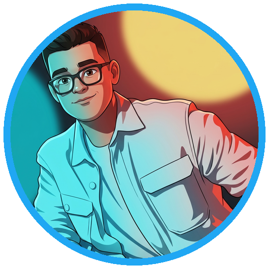

  

<h1 align="center">Игорь Борисов (Yujir0k)</h1>

  

  <strong>ML/AI-специалист · Финансовый университет · создаю AI-продукты end-to-end и решаю задачи на хакатонах</strong>

  
  
  

Я занимаюсь машинным обучением, созданием AI-продуктов и активно участвую в хакатонах. Мне нравится решать сложные практические задачи: разбираться в данных, исследовать разные подходы и создавать решения, которые можно применить в реальной жизни. Мне интересно не только работать с моделями, но и превращать идеи в полноценные продукты.

Учусь на **4 курсе Финансового университета при Правительстве РФ** по направлению **«Прикладная математика и информатика»**, профиль **«Машинное обучение»**. Большинство хакатонных проектов мы делаем вместе с нашей командой **R² negative**.

## Технический стек

  

  

## Фокусные направления

  
  
  
  
  
   
  
  
  

## Хакатоны и результаты

Ключевые результаты:

🥇 **1 место** — ReVoice25, Lenta Tech Life Hack  
🥈 **2 место** — Лидеры цифровой трансформации (Билайн Бизнес), КосмоХакатон (Ростов), WILDHACK, хакатон Роснефти, Рекламотон  
🥉 **3 место** — ИИ-хакатон Tutu, Первый городской хакатон Обнинска, АтомикХак 3.0  
🏅 **4 место, финалы и спецпризы** — КосмоХакатон (Москва), Kodik Launchpad («Выбор Kodik»), T1, Росэлторг, MORE.Tech, FINAM x HSE AI Trade Hack, Best Hack, DATA-Хакатон МГПУ

<strong>Посмотреть полную таблицу результатов</strong>

| Награда | Хакатон / организатор | Задача / кейс | Что сделали | Репозиторий |
|---|---|---|---|---|
| **🥇 1 место** 💰 40 000 ₽ | MTУСИ ReVoice25 | Восстановление качества искаженной речи | Pipeline для улучшения речи с фокусом на естественное звучание и экспертную MOS-оценку | [ReVoice25-R2negative-1st-place](https://github.com/Yujir0k/ReVoice25-R2negative-1st-place) |
| **🥇 1 место по предварительной оценке жюри** | Lenta Tech Life Hack | Контроль полки по видео прохода робота | CV/OCR-сервис для распознавания товаров, ценников, скидок, barcode/QR и экспорта результата в CSV | [Polka_pod_kontrolem](https://github.com/Yujir0k/Polka_pod_kontrolem) |
| **🥈 2 место** 💰 600 000 ₽ | Лидеры цифровой трансформации 2026 / Билайн Бизнес | Планирование маршрутов инженеров | BeeGo — интеллектуальное планирование рабочих маршрутов | [BeeGo](https://github.com/Yujir0k/BeeGo) |
| **🥈 2 место** 💰 270 000 ₽ | ML-хакатон WILDHACK / RWB | Прогноз отгрузок и диспетчеризация транспорта | ML-платформа для прогнозирования, оценки надежности и поддержки решений диспетчера | [RWB_Flow](https://github.com/Yujir0k/RWB_Flow) |
| **🥈 2 место** 💰 200 000 ₽ | КосмоХакатон 2026, Ростов-на-Дону | Спутниковый мониторинг полей | ПолеЗрение — мониторинг NDVI и помощник агронома | [ПолеЗрение](https://github.com/Yujir0k/PoleZrenie-Kosmo-Rostov) |
| **🥈 2 место** | Студенческий хакатон Роснефти | Computer Vision, semantic segmentation | SegFormer-решение для сегментации карт месторождений на 40 классов | [Oilfield-Segmentation](https://github.com/Yujir0k/Oilfield-Segmentation) |
| **🥈 2 место** | Рекламотон 2025 | Интерактивный конструктор AI-персонажей | Web-продукт для генерации AI-персонажей, аватаров и ролевого общения | [Reklamoton-2025_Fabrica-Geroev](https://github.com/Yujir0k/Reklamoton-2025_Fabrica-Geroev) |
| **🥉 3 место** 💰 25 000 ₽ | ИИ-хакатон Tutu 2026 | Сравнение офферов | Сервис сравнения поездок и отелей на данных Tutu MCP | [Tutu Comparison](https://github.com/Yujir0k/Tutu-Comparison) |
| **🥉 3 место** | Первый городской хакатон Обнинска | Кейс №3: AI-анализ здоровья полей по спутниковым снимкам | Платформа для мониторинга сельхозполей по Sentinel-2 с AI-агрономом | [R2-Farmer](https://github.com/Yujir0k/R2-Farmer) |
| **🥉 3 место** 💰 100 000 ₽ | АтомикХак 3.0 | ИИ-анализатор журналов событий приложений | AIOps-платформа для анализа логов, прогноза инцидентов и playbook-рекомендаций | [AtomikAIOps](https://github.com/Yujir0k/AtomikAIOps) |
| **🏅 4 место** | КосмоХакатон 2026, финал в Москве | Контроль качества производства | ОРБИТА.QC — рабочая среда контроля качества | [ОРБИТА.QC](https://github.com/Yujir0k/Orbita-QC-Kosmo-Moscow) |
| **🏅 4 место** | Хакатон T1 Москва | Self-Deploy: CI/CD без DevOps | CLI-продукт для автоматической генерации CI/CD pipeline без ручной DevOps-настройки | [AutoPipe-T1](https://github.com/Yujir0k/AutoPipe-T1) |
| **🏅 4 место** | Интенсив Росэлторга | Поиск закупочных процедур по номенклатурной матрице поставщика | B2B-сервис для hybrid matching и explainable поиска релевантных закупок | [RLT-Match-4th-place](https://github.com/Yujir0k/RLT-Match-4th-place) |
| **🏅 4 место / финалист трека** | MORE.Tech от ВТБ | Трек LC/NC: low-code приложение для планирования посещения офиса | Решение для планирования офисных посещений на базе low-code подхода | — |
| **🏆 Выбор Kodik (Advanced)** 💰 100 000 ₽ | Kodik Launchpad 2026 | Персонализированные сказки | Сервис создания сказок и аудиоисторий | [ТвориСказку](https://github.com/Yujir0k/TvoriSkazku) |
| **🏆 Лучшее решение кейса** | Московский студенческий DATA-Хакатон 2025 / МГПУ | Анализ транспортных потоков и рекомендации по оптимизации городской мобильности | Модель для анализа транспортных потоков и формирования рекомендаций по их оптимизации | — |
| **🎖 Финалист** | FINAM x HSE AI Trade Hack | Кейс TRADER | Решение для AI-assisted trading-задачи | — |
| **🎖 Финалист** | Best Hack | Определение пульса человека по видео | Решение для оценки пульса по видеопотоку | — |
| **📌 Участие** | Лидеры цифровой трансформации 2026 / ФСП | Кейс ФСП | Веб-сервис Офферли для проверки квалификации и подбора специалистов | [Офферли](https://github.com/Yujir0k/Offerly) |
| **📌 Участие / сертификат** | CodeGryphon Hackathon | AI-генератор маркетинговых стратегий | Zero-backend web-инструмент для генерации buyer personas, офферов и коммуникационной стратегии | [PersonaShift](https://github.com/Yujir0k/PersonaShift) |
| **📌 Участие / исследовательский кейс** | OmniSub2026 от AIRI и МТУСИ | Visual-only lip reading | Лицензионно-чистый lip-reading pipeline, построенный с нуля без аудиоканала | [OmniSub2026-lipRead-Case](https://github.com/Yujir0k/OmniSub2026-lipRead-Case) |

## Как я делаю AI-продукты

**Начинаю с сути задачи.** Мне важно не просто применить модель, а понять, какую проблему решаем, где в данных есть ценность и что в итоге должно быть удобно пользователю.

**Довожу ML до продукта.** Я не останавливаюсь на ноутбуке: собираю модель, API, интерфейс, запуск и рабочее приложение, которое можно открыть, проверить и показать.

**Использую AI как усилитель разработки.** Codex, Claude Code, Gemini, n8n, Kaggle и Colab помогают мне быстрее разбираться в задаче, проверять идеи, писать код, работать с данными и доводить прототип до продукта.

**Умею работать в хакатонном темпе.** Быстро выделяю главное, собираю MVP, довожу его до понятного продукта и умею показать, почему решение действительно полезно.

---

<strong>English version</strong>

  

<h2 align="center">Igor Borisov (Yujir0k)</h2>

  

  <strong>ML/AI specialist · Financial University · building AI products end-to-end and solving hackathon challenges</strong>

  
  
  

I work with machine learning, build AI products, and actively participate in hackathons. I enjoy solving complex practical problems: exploring data, researching different approaches, and creating solutions that can be applied in real life. I am interested not only in working with models but also in turning ideas into complete products.

I am a **4th-year student** at the Financial University under the Government of the Russian Federation, studying Applied Mathematics and Computer Science with a specialization in Machine Learning. Most of my hackathon projects are built together with my team **R² negative**.

### Tech Stack

  

  

### Focus Areas

  
  
  
  
  
   
  
  
  

### Hackathon Highlights

🥇 **1st place** — ReVoice25, Lenta Tech Life Hack  
🥈 **2nd place** — Digital Transformation Leaders (Beeline Business), KosmoHackathon (Rostov), WILDHACK, Rosneft Student Hackathon, Reklamoton  
🥉 **3rd place** — Tutu AI Hackathon, First City Hackathon of Obninsk, AtomikHack 3.0  
🏅 **4th place, finals and special prizes** — KosmoHackathon (Moscow), Kodik Launchpad (Kodik's Choice), T1, Roseltorg, MORE.Tech, FINAM x HSE AI Trade Hack, Best Hack, MSPU DATA Hackathon

<strong>View the full results table</strong>

| Result | Hackathon / organizer | Challenge | What we built | Repository |
|---|---|---|---|---|
| **🥇 1st place** 💰 40,000 ₽ | MTUCI ReVoice25 | Restoration of distorted speech | Speech enhancement pipeline focused on natural sound and expert MOS evaluation | [ReVoice25](https://github.com/Yujir0k/ReVoice25-R2negative-1st-place) |
| **🥇 1st place in the jury's preliminary assessment** | Lenta Tech Life Hack | Shelf monitoring using robot video | CV/OCR service for recognizing products, price tags, discounts and barcodes/QR codes, with CSV export | [Polka_pod_kontrolem](https://github.com/Yujir0k/Polka_pod_kontrolem) |
| **🥈 2nd place** 💰 600,000 ₽ | Digital Transformation Leaders 2026 / Beeline Business | Engineer route planning | BeeGo — intelligent planning of engineers' work routes | [BeeGo](https://github.com/Yujir0k/BeeGo) |
| **🥈 2nd place** 💰 270,000 ₽ | WILDHACK ML Hackathon / RWB | Shipment forecasting and transport dispatch | ML platform for forecasting, reliability assessment and dispatcher decision support | [RWB_Flow](https://github.com/Yujir0k/RWB_Flow) |
| **🥈 2nd place** 💰 200,000 ₽ | KosmoHackathon 2026, Rostov-on-Don | Satellite field monitoring | PoleZrenie — NDVI monitoring and an AI assistant for agronomists | [PoleZrenie](https://github.com/Yujir0k/PoleZrenie-Kosmo-Rostov) |
| **🥈 2nd place** | Rosneft Student Hackathon | Computer vision and semantic segmentation | SegFormer solution for segmenting oilfield maps into 40 classes | [Oilfield-Segmentation](https://github.com/Yujir0k/Oilfield-Segmentation) |
| **🥈 2nd place** | Reklamoton 2025 | Interactive AI character builder | Web product for generating AI characters and avatars with role-playing chat | [Reklamoton](https://github.com/Yujir0k/Reklamoton-2025_Fabrica-Geroev) |
| **🥉 3rd place** 💰 25,000 ₽ | Tutu AI Hackathon 2026 | Comparing offers | Service for comparing trips and hotels using Tutu MCP data | [Tutu Comparison](https://github.com/Yujir0k/Tutu-Comparison) |
| **🥉 3rd place** | First City Hackathon of Obninsk | AI analysis of field health using satellite imagery | Agricultural field monitoring platform using Sentinel-2 data and an AI agronomist | [R2-Farmer](https://github.com/Yujir0k/R2-Farmer) |
| **🥉 3rd place** 💰 100,000 ₽ | AtomikHack 3.0 | AI analyzer for application event logs | AIOps platform for log analysis, incident prediction and playbook recommendations | [AtomikAIOps](https://github.com/Yujir0k/AtomikAIOps) |
| **🏅 4th place** | KosmoHackathon 2026, Moscow final | Production quality control | ORBITA.QC — a quality control workspace | [ORBITA.QC](https://github.com/Yujir0k/Orbita-QC-Kosmo-Moscow) |
| **🏅 4th place** | T1 Hackathon, Moscow | Self-Deploy: CI/CD without DevOps | CLI product that automatically generates CI/CD pipelines | [AutoPipe-T1](https://github.com/Yujir0k/AutoPipe-T1) |
| **🏅 4th place** | Roseltorg Intensive | Finding procurement opportunities from supplier product catalogs | B2B service for hybrid matching and explainable procurement search | [RLT-Match](https://github.com/Yujir0k/RLT-Match-4th-place) |
| **🏅 4th place / track finalist** | VTB MORE.Tech | LC/NC track: low-code office visit planning | Low-code solution for planning office visits | — |
| **🏆 Kodik's Choice (Advanced)** 💰 100,000 ₽ | Kodik Launchpad 2026 | Personalized fairy tales | Service for creating personalized stories and audio tales | [TvoriSkazku](https://github.com/Yujir0k/TvoriSkazku) |
| **🏆 Best Case Solution** | Moscow Student DATA Hackathon 2025 / MSPU | Traffic analysis and urban mobility recommendations | Model for analyzing traffic flows and recommending improvements | — |
| **🎖 Finalist** | FINAM x HSE AI Trade Hack | TRADER case | Solution for an AI-assisted trading challenge | — |
| **🎖 Finalist** | Best Hack | Estimating heart rate from video | Video-based heart rate estimation solution | — |
| **📌 Participation** | Digital Transformation Leaders 2026 / FSP | FSP case | Offerly — a web service for assessing skills and matching specialists | [Offerly](https://github.com/Yujir0k/Offerly) |
| **📌 Participation / certificate** | CodeGryphon Hackathon | AI marketing strategy generator | Zero-backend web tool for generating buyer personas, offers and communication strategies | [PersonaShift](https://github.com/Yujir0k/PersonaShift) |
| **📌 Participation / research case** | OmniSub2026 by AIRI and MTUCI | Visual-only lip reading | License-compliant lip-reading pipeline built from scratch without audio | [OmniSub2026-lipRead-Case](https://github.com/Yujir0k/OmniSub2026-lipRead-Case) |

### How I Build AI Products

**I start with the real problem.** I care about understanding what we are solving, where the data has value and what should be useful for the end user.

**I turn ML into products.** I do not stop at notebooks: I build models, APIs, interfaces and runnable applications that can be opened, tested and presented.

**I like complex real-world tasks.** I especially enjoy CV, NLP/Speech and LLM projects where domain understanding and non-obvious technical choices matter.

**I use AI as a development multiplier.** Codex, Claude Code, Gemini, n8n, Kaggle and Colab help me research faster, test ideas, write code, work with data and turn prototypes into products.

**I work well in hackathon tempo.** I can quickly identify what matters, build an MVP, package it into a clear product and explain why the solution is useful.

## GitHub-активность

<picture>
  <source media="(prefers-color-scheme: dark)" srcset="assets/github-contribution-grid-snake-dark.svg" />
  <source media="(prefers-color-scheme: light)" srcset="assets/github-contribution-grid-snake.svg" />
  
</picture>
